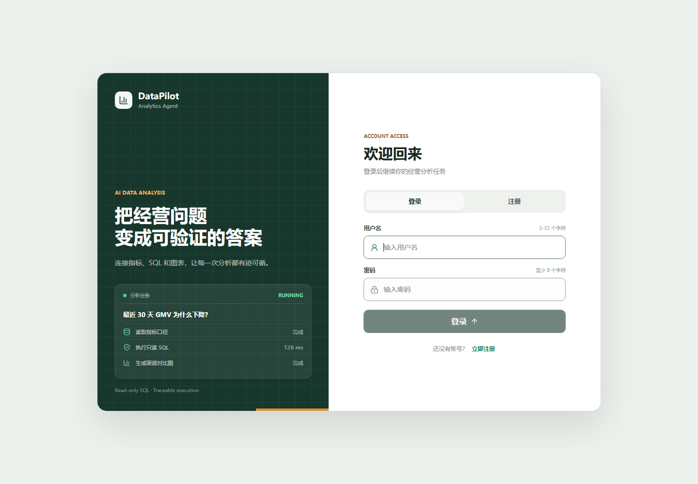
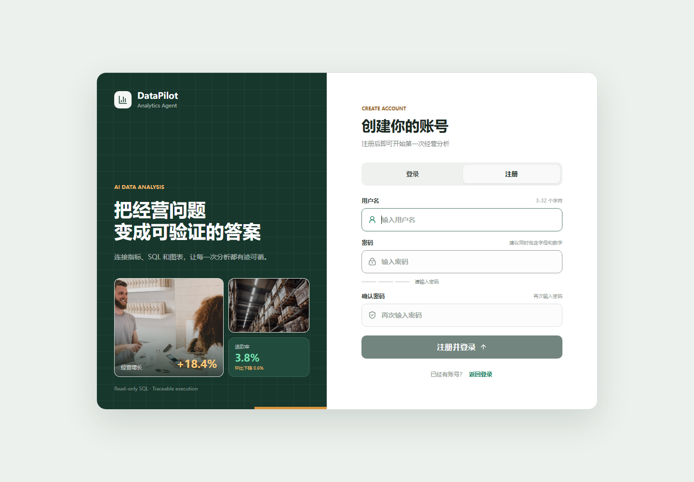
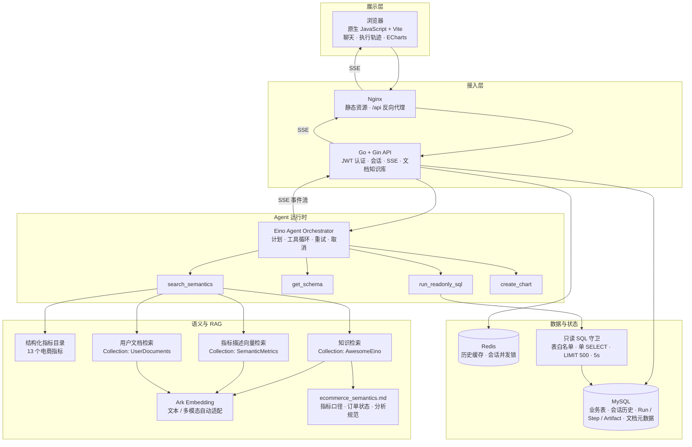

# 电商经营分析 Agent

这是一个用于简历展示的垂直 Agent 项目。用户可以用自然语言提出经营问题，也可以上传文档建立个人知识库；Agent 会查询 MySQL 或检索文档向量，返回分析过程、图表和结论。

例如：

> 分析最近一个月 GMV 的变化，并按渠道拆解原因。

## 学习与面试材料

- [7 天学习路线](docs/learning/README.md)
- [架构、调用链与时序](docs/learning/architecture-and-flows.md)
- [项目介绍与面试题](docs/learning/interview-guide.md)
- [第 7 天扩展示例](docs/learning/day7-extension.md)

## 界面预览





## 系统架构



`search_semantics` 支持两种数据模式。内置电商模式下检索指标描述和业务知识，向量召回失败时回退关键词检索；选择用户上传的文档知识库后，Agent 只注册文档检索工具，按 `dataset_id` 从 `UserDocuments` 集合召回片段，不允许执行 SQL。

## 核心流程

```text
用户提问
  |
  v
Agent 制定分析计划
  |
  +-- 检索指标定义
  +-- 查看数据表结构
  +-- 执行只读 SQL
  +-- 生成 ECharts 图表
  |
  v
返回经营结论和执行过程
```

项目重点不是“万能聊天”，而是展示三件事：

1. 让大模型通过工具查询真实数据，而不是编造答案。
2. SQL 只能读取指定业务表，并限制返回行数和执行时间。
3. 前端能看到每次分析调用了什么工具、执行了什么 SQL、得到了什么结果。

## 功能

- 自然语言经营问数
- 13 个电商指标语义层
- 指标描述向量化与相似度召回
- 单编排器 Agent，最多执行 8 步
- 工具调用：`search_semantics`、`get_schema`、`run_readonly_sql`、`create_chart`
- 只读 SQL 守卫和独立只读数据库账号
- SSE 实时展示分析步骤
- Run、Step、ToolCall、Artifact 持久化
- ECharts 图表和 Markdown 经营报告
- 复用现有注册、登录、会话和历史记录
- 支持上传 Markdown、TXT、DOCX 文档并建立个人知识库
- 支持上传 XLSX 并创建用户私有的可查询数据表

## 上传数据文件

登录后点击左侧“上传数据文件”：

文档文件：

1. 选择 `.md`、`.markdown`、`.txt` 或 `.docx` 文件。
2. 后端解析正文，清理异常字符，并按 Markdown 标题层级和段落边界切块。
3. 文档片段调用 Ark Embedding 后写入 Milvus 的 `UserDocuments` 集合。
4. 在输入框上方选择刚上传的知识库。
5. Agent 只会检索并引用当前文档片段。

Excel 文件：

1. 选择 `.xlsx` 文件，默认导入第一个非空工作表；接口也支持通过 `sheet` 字段指定工作表。
2. 后端读取第一个非空行作为表头，推断 `BIGINT`、`DOUBLE`、`DATETIME` 或 `TEXT` 类型。
3. 系统创建形如 `user_dataset_<uuid>` 的用户私有 MySQL 表，并批量写入数据。
4. 在输入框上方选择该数据集后，Agent 只能查询这一张表，通过只读 SQL 和图表分析结果。

当前限制：

- 单文件不超过 20MB。
- 清洗后正文不超过 100 万字符，切分后最多 500 个片段。
- Excel 最多 50,000 行、100 列，单元格最多 32,000 字符。
- 文档只支持 Markdown、TXT 和 DOCX；Excel 只支持 `.xlsx`。
- 一次 Excel 上传只导入一个工作表，不支持追加或覆盖。
- 用户只能检索自己上传的文档。

相关接口：

- `POST /api/datasets`
- `POST /api/datasets/excel`
- `GET /api/datasets`
- `PATCH /api/datasets/{id}`
- `DELETE /api/datasets/{id}`

文档会根据类型和清洗后的正文计算指纹，Excel 会根据文件内容和所选工作表计算指纹。名称相同但内容不同的数据集仍可上传，前端只会提示确认；内容完全相同的重复上传会返回 `409 Conflict`。

## 技术栈

- Go + Gin
- CloudWeGo Eino
- MySQL
- Redis
- Milvus
- 原生 JavaScript + Vite

## 启动

首次启动：

```powershell
Copy-Item .env.example .env
docker compose up -d --build
docker compose --profile tools run --rm seed
docker compose --profile tools run --rm rag-index
```

RAG 默认使用文本 Embedding 接口；模型名称包含 `vision` 时会自动切换到多模态 Embedding 接口。也可以通过 `EMBEDDER_API_TYPE=text|multi_modal` 显式覆盖。`rag-index` 会同时重建知识库集合 `AwesomeEino` 和指标向量集合 `SemanticMetrics`。

访问：

- Web：`http://127.0.0.1:5678`
- 健康检查：`http://127.0.0.1:5678/healthz`

## 本地开发

```powershell
docker compose up -d mysql redis etcd minio standalone attu
go run ./cmd/seed
go run ./cmd/rag-index -source ./knowledge/ecommerce_semantics.md -drop
go run ./cmd/server
```

前端：

```powershell
cd frontend
npm install
npm run dev
```

## 分析接口

启动一次分析：

```http
POST /api/analysis/runs
Authorization: Bearer <JWT>
Content-Type: application/json
```

```json
{
  "session_id": "0c7f8c7e-...",
  "question": "分析最近一个月 GMV 变化，并按渠道拆解原因"
}
```

订阅执行过程：

```http
GET /api/analysis/runs/{run_id}/events
Authorization: Bearer <JWT>
```

取消任务：

```http
POST /api/analysis/runs/{run_id}/cancel
```

## SQL 安全

- 只允许单条 `SELECT` 或 CTE。
- 只允许访问 8 张电商业务表。
- 禁止系统库、注释、DDL、DML 和多语句。
- 自动限制最多返回 500 行。
- SQL 最多执行 5 秒。
- 后端使用独立只读 MySQL 账号。

## 测试

```powershell
go test ./...
go vet ./...
cd frontend
npm run build
docker compose config --quiet
```

## 简历描述示例

> 基于 Go、Eino 和 MySQL 实现电商经营分析 Agent，设计 Retry/工具调用循环和只读 SQL 守卫，将 NL2SQL 转化为可审计的多步取数流程；通过 SSE 实时展示计划、SQL、图表和结论，并使用语义层提升指标口径一致性。

这个项目保持单 Agent 和四个工具，目标是把执行链路做完整、能演示、容易讲清楚。
